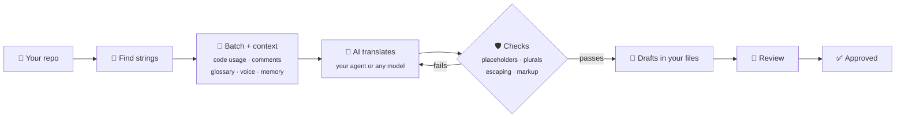

<div align="center">

# 🌍 Localship

**Translate your app with the AI you already use.**

Free and open source · No account, no server · Any AI model · Every translation checked

[](https://www.npmjs.com/package/localship)
[](https://github.com/jigarfumakiya/localship/actions/workflows/ci.yml)
[](LICENSE)
[](https://modelcontextprotocol.io)
[](CONTRIBUTING.md)

[Highlights](#-highlights) · [See it in action](#-see-it-in-action) · [How it works](#-how-it-works) · [What you can ask](#-what-you-can-ask) · [Formats](#-formats) · [Install](#-install) · [Questions](#-questions) · [Roadmap](#%EF%B8%8F-roadmap) · [Reference](docs/reference.md)

</div>

---

Ask your coding agent to translate your app. Localship gives it the context it needs, checks
every translation before it's written, and remembers what's done, so updates only redo what
changed. Think of it as a localization platform that runs inside your coding agent: no account,
no server, no monthly bill.

> [!NOTE]
> **Early days.** Localship is new. It's tested on real-world translation files and a real app,
> but expect rough edges, and please [open an issue](https://github.com/jigarfumakiya/localship/issues)
> when you hit one.

## ✨ Highlights

- 🆓 **Free and open source.** MIT-licensed. You pay only for your own AI usage, or nothing with a
  local model.
- 🤖 **Your AI, your model.** Your coding agent's own model, or Claude, GPT, Gemini, OpenRouter
  or Ollama.
- 🛡️ **Catches broken translations.** Placeholders, plural forms, escaping and markup are checked
  in code before anything is written. Failures go back to the AI with the reason.
- 🧠 **More context for the AI.** Each string comes with the code that uses it, its comment, your
  glossary and voice notes, and earlier translations of the same text.
- 🔒 **Your files, your workflow.** No Localship server or account. Translation files stay in your
  repo, formatted the way your tools write them. You choose the AI that receives their content.
- 👀 **Review in your browser.** `localship review` opens a page on your computer with source and
  translation side by side, where you edit, approve or reject them, one at a time or all at once.
- ✅ **Check before release.** Require current, approved translations in CI with
  `localship validate --require-approved`. No model call or API key needed for the check.
- 💻 **Runs anywhere.** Claude Code, Cursor, VS Code, Codex, Gemini CLI, Claude Desktop or the
  terminal, on macOS, Linux and Windows.

### 🤔 Why use Localship?

| | ❌ Asking an AI directly | ✅ With Localship |
|---|---|---|
| Context | One string at a time | Code, comments, brief and glossary |
| Placeholders | Sometimes dropped | Checked before writing |
| Plural forms | Often incomplete | Every form each language needs |
| Escaping and markup | Can break the build | Checked and escaped |
| Terms and tone | Drift across strings | Same glossary and voice everywhere |
| Changed copy | Everything redone | Only what changed |
| Your edits | Overwritten | Kept |

## 🎬 See it in action

```
You:    Translate this app into Hindi and Arabic.
Agent:  Translating 18 strings into Hindi and Arabic…
        36 translations written as drafts, 0 errors. Arabic has all six plural forms.
        Hindi addresses the user as आप, and "Jotter Pro" is kept as written.

You:    Review the Arabic, then approve them.
Agent:  Two small fixes made. All approved.

You:    I reworded two buttons. Update the translations.
Agent:  Updated the 2 changed strings. Your hand edit in Hindi was kept.
```

## 🔍 How it works



Setup adds one folder to your repo. Commit it: the brief, glossary and voice notes are yours to
edit, and the lockfile is how Localship knows what's new, what changed and what someone edited by
hand.

```
.localship/
├── config.yaml     where your strings live, and which languages
├── brief.md        what the app is and who it's for
├── glossary.yaml   terms to keep as they are or translate one way
├── voice/          tone and formality per language
└── lock.json       what was translated from which text
```

## 💬 What you can ask

Wherever your app is today, one sentence gets it started.

| Your app today | Just ask |
|---|---|
| 📝 Has strings, no translations yet | "Translate the app into French and German." |
| 🌐 Already has some translations | "Set up localization." Existing translations are kept and checked |
| 🧱 Text is written straight into the code | "Make this app localizable." The agent moves it into `strings.xml` or a String Catalog |
| ➕ Adding a language later | "Add Japanese." |
| ✏️ You changed some copy | "Update the translations." Only changed strings are redone |
| 🧹 You deleted or renamed strings | "Clean up old translations." |
| 👀 Ready to check the result | "Review the Arabic translations." |
| 🖥️ Want to check them yourself | "Open the review page." Source and translation side by side in your browser |

## 📦 Formats

| Format | Used by | Status |
|---|---|---|
| Android `strings.xml` | Android (Kotlin, Java, Compose) | ✅ Supported |
| Apple String Catalog `.xcstrings` | iOS, macOS (SwiftUI, UIKit) | ✅ Supported |
| gettext `.po` / `.pot` | Django, WordPress, PHP, C, Python | ✅ Supported |
| Flutter ARB `.arb` | Flutter (`flutter gen-l10n`, `intl`) | ✅ Supported |
| JSON (flat, nested, i18next, ICU) | React, Vue, Next.js, React Native (i18next, react-intl, next-intl) | ✅ Supported |
| Apple `.strings` / `.stringsdict` | Older iOS projects | 🗓️ Planned |
| XLIFF `.xliff` | Angular, translation agencies | 🗓️ Planned |

Setup finds these on its own. To write the config by hand, a Flutter app and a web app look like
this:

```yaml
targets:
  - format: arb
    path: lib/l10n/app_{locale}.arb            # the source language's file is the template
  - format: json
    path: public/locales/{locale}/common.json  # i18next; add `placeholders: icu` for react-intl or next-intl
```

Android string arrays and plurals, String Catalog plural variations, gettext plural forms, ICU
plurals in ARB and JSON, and i18next `_one`/`_other` keys are all supported.

Apple device/nested variations and substitutions, and Android strings in configuration-specific
folders such as `values-ar-night`, are preserved but not translated or validated. Localship reports
these coverage gaps; `validate --strict` and `--require-approved` fail rather than claim completeness.
See [platform verification](skills/localship-extract/references/platform-localization.md) for native
build, language setup and device checks.

## 🚀 Install

**Claude Code plugin**

```
/plugin marketplace add jigarfumakiya/localship
/plugin install localship@localship
```

**Claude Code, Codex, Gemini CLI and other CLIs:** add the server, then the skills.

```sh
claude mcp add localship -- npx -y localship mcp   # Claude Code
codex mcp add localship -- npx -y localship mcp    # Codex
gemini mcp add localship npx -y localship mcp      # Gemini CLI
npx skills add jigarfumakiya/localship             # the skills, for any agent
```

**Cursor and VS Code**

[](https://cursor.com/en/install-mcp?name=localship&config=eyJjb21tYW5kIjoibnB4IiwiYXJncyI6WyIteSIsImxvY2Fsc2hpcCIsIm1jcCJdfQ%3D%3D)
[](https://insiders.vscode.dev/redirect?url=vscode%3Amcp%2Finstall%3F%257B%2522name%2522%253A%2522localship%2522%252C%2522command%2522%253A%2522npx%2522%252C%2522args%2522%253A%255B%2522-y%2522%252C%2522localship%2522%252C%2522mcp%2522%255D%257D)

Add the skills too: `npx skills add jigarfumakiya/localship`.

Now ask your agent: *"Translate this app into Hindi and Arabic."* Needs Node.js 22 or newer.

### 🔌 Other tools

Add this MCP server to your tool's config:

```json
{ "mcpServers": { "localship": { "command": "npx", "args": ["-y", "localship", "mcp"] } } }
```

| Tool | Config file |
|---|---|
| Cursor | `.cursor/mcp.json` |
| VS Code | `.vscode/mcp.json` (use `"servers"`) |
| Claude Desktop | `claude_desktop_config.json` (add `"-C", "/path/to/app"` before `"mcp"`) |

<details>
<summary><b>MCP tools</b></summary>

Your agent picks these itself; you just ask. 👀 marks tools that only read and never change a file.

| Tool | What it does |
|---|---|
| `localship_plan` 👀 | Looks at what a request involves: files, strings to translate, anything in the way |
| `localship_start` | Writes the config for the languages, or adds them to it |
| `localship_status` 👀 | Progress per language: missing, changed, drafts, approved |
| `localship_validate` 👀 | Checks placeholders, plural forms, escaping, markup and the glossary |
| `localship_detect` 👀 | Finds translation files in the repo |
| `localship_init` | Writes the config from what was detected |
| `localship_add_locales` | Adds languages to translate into |
| `localship_get_context` 👀 | Reads the brief, voice notes and glossary |
| `localship_update_context` | Writes the brief, voice notes or glossary |
| `localship_next_batch` 👀 | The next strings to translate, with their context |
| `localship_submit` | Checks translations and writes the good ones as drafts |
| `localship_approve` | Marks drafts reviewed or approved, when you say so |
| `localship_review` | Opens a review page where you edit, approve or reject translations yourself |
| `localship_remove` | Clears translations so they're redone; keeps your edits unless you ask |
| `localship_prune` | Removes translations of deleted strings |
| `localship_translate` | Translates everything missing through a model API, for large apps |

</details>

## 🔒 Security and privacy

- **Stays in your project.** Localship reads and writes only your translation files and the
  `.localship/` folder. Changes to your code are made by your agent, where you can see them.
- **No Localship server.** No account, no telemetry. Localship's model calls go to the provider
  you configure. When you use a cloud coding agent, that agent may send strings and context to
  its model provider. Validation runs locally without model calls; translation can also stay
  local when you use a locally hosted model.
- **Nothing is final until you say so.** Translations are written as drafts, and hand edits and
  approved translations are never replaced unless you ask.

## ⌨️ From the command line

No agent needed: run Localship straight from your terminal with any model.

```sh
npm install -g localship

localship plan hindi arabic                                 # what it takes, before changing anything
localship start hi,ar --model anthropic:claude-sonnet-5-5   # set up and translate in one go
localship status                                            # progress per language
localship validate                                          # exits 1 on errors
localship review --locale ar                                # review page in your browser
localship approve --locale hi                               # after review
localship validate --require-approved                       # release / CI check
```

Every command, option and config key is in the [reference](docs/reference.md).

## ❓ Questions

<details>
<summary><b>The Localship tools don't show up. What do I check?</b></summary>

- Node.js 22 or newer: run `node --version`.
- The first start takes a minute while it installs; try again after that.
- Reconnect the server: `/mcp` in Claude Code, or restart your editor.
- Open your app's folder in your tool, so Localship starts in the right project.
</details>

<details>
<summary><b>Can I try it before using it on my app?</b></summary>

Yes. [examples/android-notes](examples/android-notes) is a small Android app with its Hindi and
Arabic translations. Open it with Localship installed and ask your agent to add another language.
</details>

<details>
<summary><b>Do I need an API key?</b></summary>

No. Inside a coding agent, Localship uses the agent's own model. An API key is only needed to
translate from the terminal or CI, and a local model through Ollama needs none at all.
</details>

<details>
<summary><b>Where do my strings go?</b></summary>

Only to the AI you choose. There's no Localship server.
</details>

<details>
<summary><b>Will it overwrite my translators' work?</b></summary>

No. Hand edits and anything approved are never replaced unless you explicitly ask.
</details>

<details>
<summary><b>I have an iOS, an Android and a web app. Can they share translations?</b></summary>

Yes. One config can list all of them, and they share the same brief, glossary and voice notes.
When the same text appears in more than one app, the earlier translation is offered to the AI, so
"Sign in" reads the same everywhere.
</details>

<details>
<summary><b>Does it work with Flutter, React or Next.js?</b></summary>

Yes. Flutter's `.arb` files and JSON files for i18next, react-intl, next-intl and similar libraries
are supported. ICU plurals (`{count, plural, one{…} other{…}}`) and i18next plural keys
(`items_one`, `items_other`) get every form each language needs, so Arabic gets six. Translators
also see where each key is used, from `AppLocalizations.of(context)!.save` in Dart or `t("nav.home")`
in JavaScript.
</details>

<details>
<summary><b>Which languages?</b></summary>

Any. Plural rules come from Unicode's CLDR data, so Arabic gets six plural forms, Russian three and
Japanese one, automatically.
</details>

<details>
<summary><b>How good are the translations?</b></summary>

As good as the model and the context you give it. The brief, voice and glossary make the biggest
difference. The checks catch mechanical errors, not wrong meaning, so review the drafts, ideally
with a native speaker.
</details>

<details>
<summary><b>Does it check right-to-left layout and cut-off text?</b></summary>

Not yet. Localship checks the translation files, not how your app draws them. Charts that don't
mirror, signs on the wrong side of amounts, or text stored in a database won't show up in the
files, so test right-to-left languages on a device before you ship. The agent skills list what
to look for.
</details>

## 🛣️ Roadmap

| | Feature | Status |
|---|---|---|
| 📦 | Android, String Catalog and gettext formats | ✅ Done |
| 🧩 | Flutter ARB and JSON (i18next, flat, nested, ICU) | ✅ Done |
| 🧠 | Translation with context, checks, review, approval and cleanup | ✅ Done |
| 🤖 | MCP server, agent skills, Claude Code plugin | ✅ Done |
| 👀 | Review page for people (`localship review`) | ✅ Done |
| ✅ | GitHub Action that checks pull requests | 🗓️ Planned |
| 🔎 | Tools that find hardcoded text in Kotlin and Swift | 🗓️ Planned |
| 👀 | Review page for people (`localship review`) | ✅ Done |
| 🤖 | AI reviewer | 🗓️ Planned |
| 🏪 | App Store and Play Store listings | 🗓️ Planned |
| 📱 | Screenshot checks for cut-off and right-to-left text | 🗓️ Planned |

Want something sooner? [Open an issue](https://github.com/jigarfumakiya/localship/issues) or 👍 an existing one.

## 🤝 Contributing

Found a bug or have an idea? [Open an issue](https://github.com/jigarfumakiya/localship/issues).
